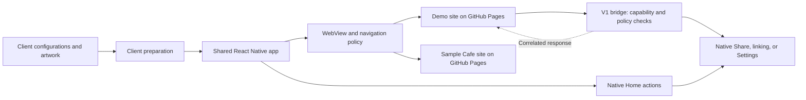

# WhiteLabelApp

A hosted webpage opens Android's native share sheet through a capability-checked React Native WebView bridge. The same app code ships as **Demo**, which exposes that bridge, and **Sample Cafe**, a separately branded Android app with a native Home and an independently hosted café site.

| Client | What to look for | Android application ID |
| --- | --- | --- |
| **Demo** | Open **View Portfolio → Native Bridge** to see a webpage request a native action and receive the correlated result. [Hosted bridge page](https://dacodahub.github.io/mobile-demo/bridge.html) | `com.dacodahub.whitelabel.demo` |
| **Sample Cafe** | Open **View Menu** on native Home to see the hosted menu inside a branded WebView. [Hosted café](https://dacodahub.github.io/mobile-demo/sample-cafe/) | `com.whitelabel.samplecafe` |

## Visual showcase

| Sample Cafe native Home | Hosted menu in the Android WebView |
| --- | --- |
|  |  |

### Additional captures planned

| Capture | What to show | Proposed asset |
| --- | --- | --- |
| Sample Cafe hosted homepage | Coffee hero and **View Menu** at mobile width. [Open homepage](https://dacodahub.github.io/mobile-demo/sample-cafe/) | `assets/readme/sample-cafe-hosted-home.png` |
| Native-to-web navigation | Tap **View Menu**, show the hosted menu, then use native Back | `assets/readme/sample-cafe-navigation.mp4` |
| Demo Native Share | Tap **Open native share sheet**, show the Android chooser, then return to the matching response | `assets/readme/demo-native-share.mp4` |

## Engineering highlights

- **Two Android apps from one codebase.** Each client owns its runtime config, native identifiers, environment values, and source artwork. Preparation validates the selection and deterministically generates the active TypeScript module, Android metadata, launcher and splash resources, and runtime logo. Both builds share the same Kotlin source namespace and Gradle project.
- **A bounded WebView bridge.** Demo's top-frame wrapper adds a native-generated capability scoped to the WebView. The app checks the capability, reported URL and current page, request size and schema, allowed action types, and feature flags. Sample Cafe leaves the bridge disabled.
- **Native Share with a correlated result.** The V1 `share` request carries an ID. The app combines text and HTTPS URL for the Android chooser and dispatches a safe `freelanceAppBridgeResponse` event containing the matching `requestId`. Recent IDs are deduplicated in memory.
- **Independent web deployment.** GitHub Pages serves both websites from a separate repository. The apps load configured HTTPS destinations and can launch supported external links through the system.
- **Native navigation and recovery.** React Navigation owns the screen stack. Android hardware Back consumes WebView history first when available. The WebView handles loading, progress, page and renderer errors, and retry.

## Architecture



The diagram shows Demo's website-to-native request path. Sample Cafe loads hosted content and runs its Call and Directions actions from native Home. See the [client definitions](clients/), [WebView shell](src/presentation/webview/), [bridge parser and executor](src/app/webBridge/), and [platform adapters](src/infrastructure/).

## Technology stack

React Native 0.86, React, TypeScript, React Navigation, and React Native WebView. The Android host uses Kotlin and Gradle with Hermes and Fabric enabled. Metro bundles the app, and Jest, ESLint, and TypeScript check it on the host. The companion sites use static HTML, CSS, and JavaScript on GitHub Pages.

## Running the project

Use Node **22.13.0** from [`.nvmrc`](.nvmrc), JDK 17, and the Android SDK with platform and build tools 36, platform-tools (`adb`), and NDK `27.1.12297006`. Start an emulator or connect an Android device with USB debugging. From the repository root:

```sh
npm ci

# Prepare Demo
npm run client:prepare -- demo development

# Or prepare Sample Cafe
npm run client:prepare -- sample-cafe development
```

Start Metro in one terminal and build, install, and launch the same client in another:

```sh
# Terminal 1
node scripts/clientRun.js start --client demo --environment development

# Terminal 2
node scripts/clientRun.js android --client demo --environment development --no-packager
```

For **Sample Cafe**, use `--client sample-cafe` in both commands. The runner prepares the selected client before starting Metro or Android and passes the correct Android application ID to the CLI. The explicit preparation commands are useful before host checks or a direct Gradle build.

Both clients share [`metro.config.js`](metro.config.js), the default Metro port, and one generated active-client module. To switch, stop Metro, restart it with the other client, and rerun Android for that same client. Distinct application IDs allow both apps to be installed together. A single checkout serves one prepared client at a time.

If multiple devices are attached, boot the desired emulator, identify its serial with `adb devices`, and pass it as `--device`. Replace the example serial with the one listed on your machine.

```sh
adb devices
node scripts/clientRun.js android --client sample-cafe --environment development --no-packager --device emulator-5554
```

Start Metro for Sample Cafe before running that command. Use `npm run client:list` to inspect available client definitions.

## Testing and validation

```sh
npm run client:prepare -- demo development
npm run lint
npm run typecheck
npm test -- --runInBand
```

| Evidence | Coverage |
| --- | --- |
| **Host checks** | Lint, TypeScript, and Jest cover client validation and preparation, Home actions, URL policy, bridge parsing and authorization, Share outcomes, response serialization, and WebView loading and retry. Platform calls are mocked in Jest. |
| **Android builds** | Debug APK builds were validated for Demo and Sample Cafe on ARM64. Sample Cafe also built for x86_64. Build success verifies compilation and packaging. |
| **Physical Android** | On a Pixel 3a, a request sent through the authorized wrapper from the hosted page opened the system chooser with both text and URL. The matching request ID returned with **Share sheet opened.** That device run used the wrapper from WebView DevTools. |

To verify the current hosted button with the app, open **View Portfolio → Native Bridge**, tap **Open native share sheet**, confirm the chooser preview, and press Back. The page should display **Share sheet opened.** for the same request ID. Android reports chooser launch and gives no reliable dismissal or delivery signal.

## Known limitations

- An intermittent Android startup `SIGSEGV` in Fabric mounting was recorded on a Pixel 3a. The trigger and root cause remain unresolved.
- The bridge authorizes configured HTTPS hostnames and their subdomains. It trusts scripts running in the authorized top-level page, and its capability lasts for the WebView lifetime.
- WhiteLabelApp is a portfolio engineering showcase. The Android workflow is the validated focus, and production signing and iOS device behavior are outside that validation.

## Related repository

[DaCodaHUB/mobile-demo](https://github.com/DaCodaHUB/mobile-demo) owns the Demo and Sample Cafe website source and the GitHub Pages deployment. Website changes can ship independently of the Android APK.
