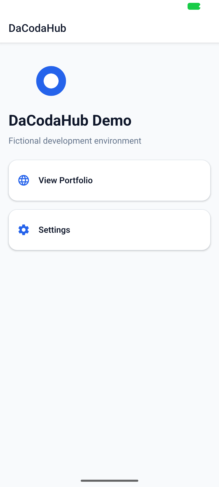
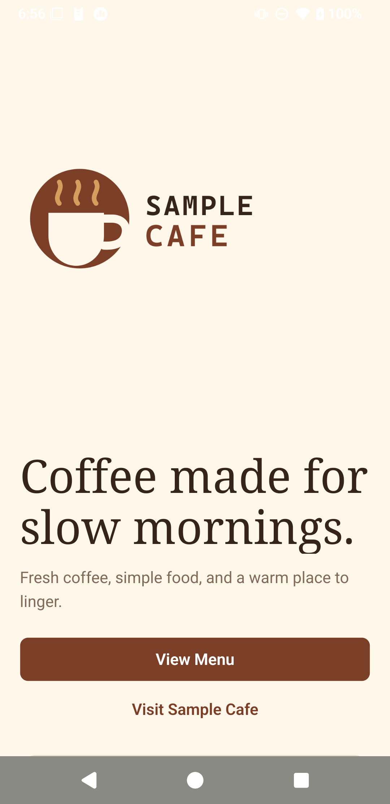
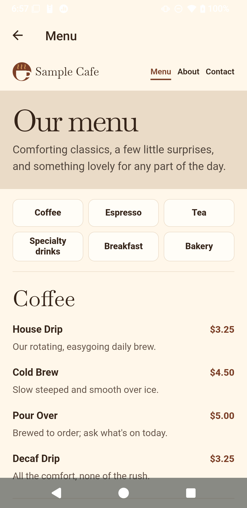
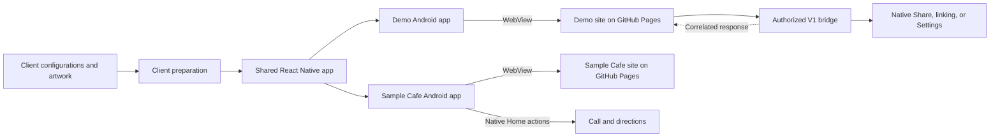

# WhiteLabelApp

**One React Native codebase, two Android applications.** Demo exposes a capability-checked bridge from hosted content to Android actions. Sample Cafe uses the same implementation to deliver a branded native Home and an independently hosted café menu. Each app has its own Android application ID, artwork, and feature configuration.

| Client | What to look for | Android application ID |
| --- | --- | --- |
| **Demo** | Technical showcase for WebView navigation and authorized native actions. [Hosted bridge page](https://dacodahub.github.io/mobile-demo/bridge.html) | `com.dacodahub.whitelabel.demo` |
| **Sample Cafe** | Customer-facing café experience with branded native Home and a hosted menu. [Hosted café](https://dacodahub.github.io/mobile-demo/sample-cafe/) | `com.whitelabel.samplecafe` |

## Visual showcase

**Native Home screens** · Demo (left) and Sample Cafe (right). Select either screenshot to see it full size.

<p>
  <a href="assets/readme/demo-native-home.png"></a>
  <a href="assets/readme/sample-cafe-native-home.png"></a>
</p>

**From native Home to hosted content.** Sample Cafe's **View Menu** action opens the independently deployed menu and keeps a native Back control visible.



## Architecture



- **Client selection happens before bundling and build.** Preparation validates one client and deterministically generates the active TypeScript module, Android metadata, launcher and splash artwork, and runtime logo. Both builds share a Kotlin source namespace and Gradle project. [Client definitions](clients/) · [Preparation script](scripts/clientPrepare.js)
- **Web content deploys independently.** Both apps load configured HTTPS destinations in the shared WebView. React Navigation owns the native stack, and Android hardware Back uses WebView history when available. The shell handles loading, page and renderer errors, and retry. [WebView shell](src/presentation/webview/)
- **Native capabilities are granted per client.** Demo's top-frame wrapper attaches a native-generated capability scoped to the WebView. The app checks the capability, reported and current page URLs, payload size and schema, permitted action types, and feature flags. Sample Cafe keeps the bridge disabled and exposes Call and Directions through native Home. [Bridge implementation](src/app/webBridge/)
- **Native Share demonstrates the round trip.** A V1 `share` request carries an ID, text, and an HTTPS URL. Android opens the system chooser and the page receives a safe `freelanceAppBridgeResponse` carrying the original `requestId`. Recent IDs are deduplicated. The response confirms chooser launch. Android provides no reliable delivery or dismissal signal. [Share adapter](src/infrastructure/sharing/ReactNativeShareService.ts)

## Technology stack

React Native 0.86, React, TypeScript, React Navigation, and React Native WebView. The Android host uses Kotlin and Gradle with Hermes and Fabric enabled. Metro bundles the app, and Jest, ESLint, and TypeScript check it on the host. The companion sites use static HTML, CSS, and JavaScript on GitHub Pages.

## Running the project

Use Node **22.13.0** from [`.nvmrc`](.nvmrc), JDK 17, and the Android SDK with platform and build tools 36, platform-tools (`adb`), and NDK `27.1.12297006`. Start an emulator or connect an Android device with USB debugging. From the repository root:

```sh
npm ci

# Prepare Demo
npm run client:prepare -- demo development

# Or prepare Sample Cafe
npm run client:prepare -- sample-cafe development
```

Start Metro in one terminal and build, install, and launch the same client in another:

```sh
# Terminal 1
node scripts/clientRun.js start --client demo --environment development

# Terminal 2
node scripts/clientRun.js android --client demo --environment development --no-packager
```

For **Sample Cafe**, use `--client sample-cafe` in both commands. The runner prepares the selected client before starting Metro or Android and passes the correct Android application ID to the CLI. The explicit preparation commands are useful before host checks or a direct Gradle build.

Both clients share [`metro.config.js`](metro.config.js), the default Metro port, and one generated active-client module. To switch, stop Metro, restart it with the other client, and rerun Android for that same client. Distinct application IDs allow both apps to be installed together. A single checkout serves one prepared client at a time.

If multiple devices are attached, boot the desired emulator, identify its serial with `adb devices`, and pass it as `--device`. Replace the example serial with the one listed on your machine.

```sh
adb devices
node scripts/clientRun.js android --client sample-cafe --environment development --no-packager --device emulator-5554
```

Start Metro for Sample Cafe before running that command. Use `npm run client:list` to inspect available client definitions.

## Testing and validation

```sh
npm run client:prepare -- demo development
npm run lint
npm run typecheck
npm test -- --runInBand
```

| Evidence | Coverage |
| --- | --- |
| **Host checks** | Lint, TypeScript, and Jest cover client validation and preparation, Home actions, URL policy, bridge parsing and authorization, Share outcomes, response serialization, and WebView loading and retry. Platform calls are mocked in Jest. |
| **Android builds** | Debug APK builds were validated for Demo and Sample Cafe on ARM64. Sample Cafe also built for x86_64. Build success verifies compilation and packaging. |
| **Physical Android** | On a Pixel 3a, a request sent through the authorized wrapper from the hosted page opened the system chooser with both text and URL. The matching request ID returned with **Share sheet opened.** That device run used the wrapper from WebView DevTools. |

To try the hosted button in Demo, open **View Portfolio → Native Bridge**, tap **Open native share sheet**, and confirm the chooser preview and the correlated result after returning to the page.

## Known limitations

- An intermittent Android startup `SIGSEGV` in Fabric mounting was observed on a Pixel 3a. The trigger and root cause remain unresolved.
- The bridge trusts scripts running in the authorized top-level page. Its configured host policy includes matching subdomains.
- WhiteLabelApp is a portfolio engineering showcase. Android debug builds are the focus of validation. Production signing and iOS device behavior are outside that validation.

## Related repository

[DaCodaHUB/mobile-demo](https://github.com/DaCodaHUB/mobile-demo) owns the Demo and Sample Cafe website source and the GitHub Pages deployment. Website changes can ship independently of the Android APK.
